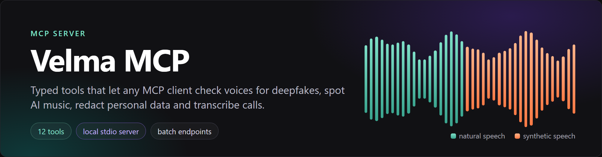
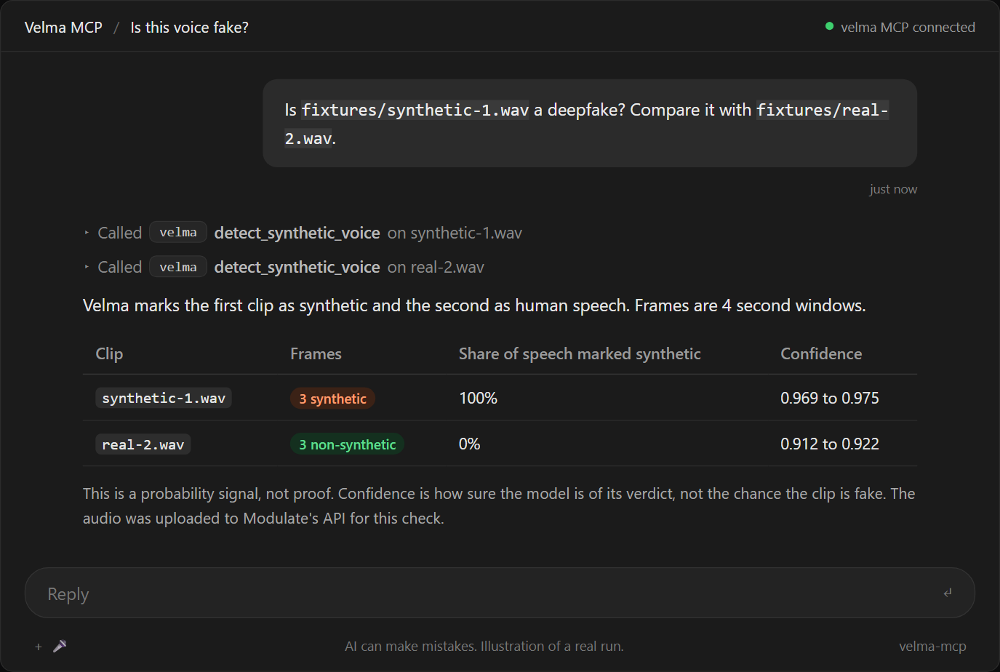
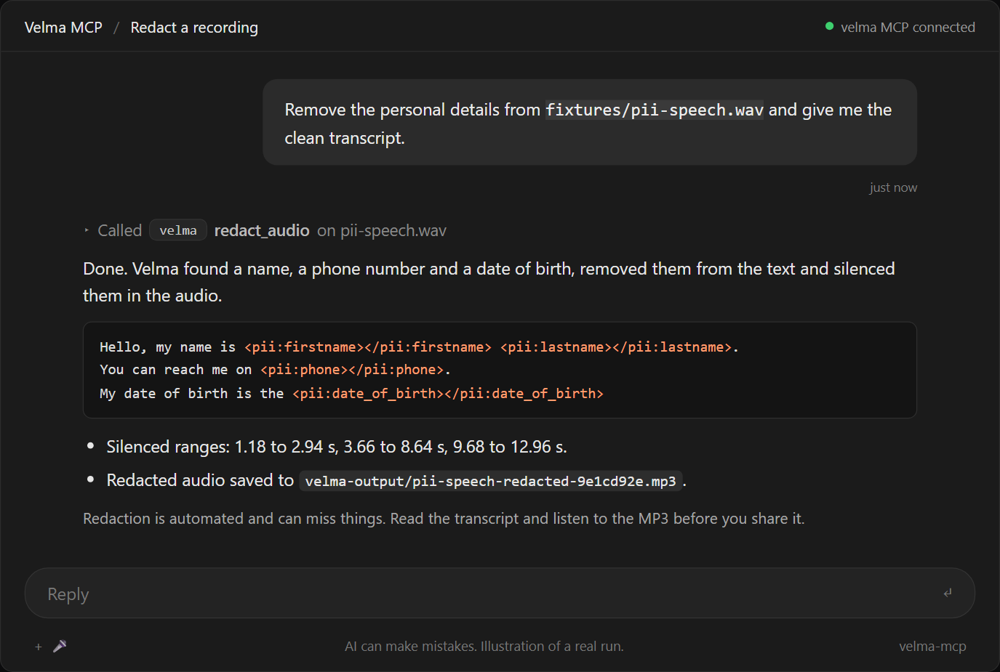
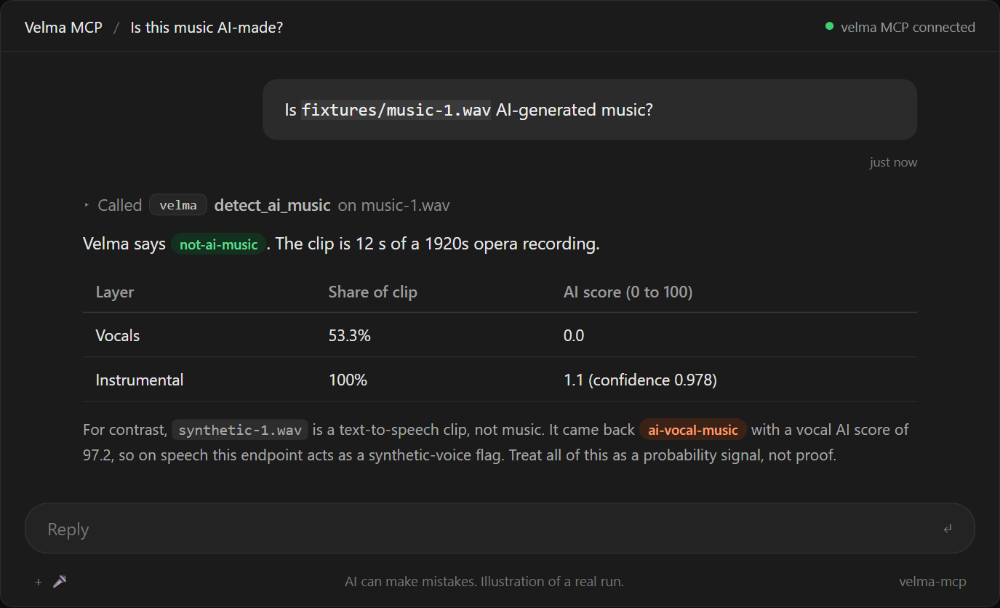
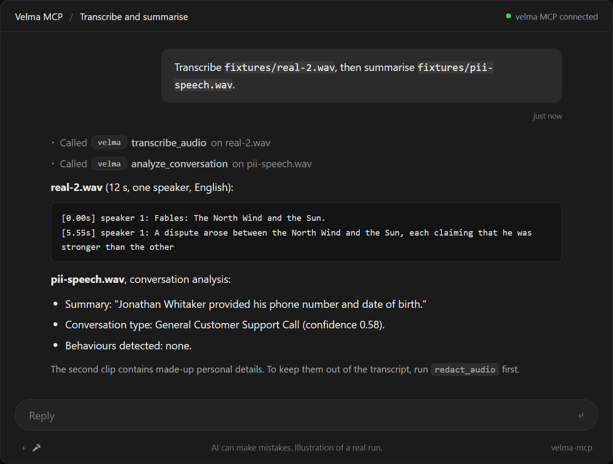

# Velma MCP

[](./LICENSE)
[](https://www.python.org)
[](https://modelcontextprotocol.io)

A local [Model Context Protocol](https://modelcontextprotocol.io) server for [Modulate's Velma](https://docs.modulate.ai) voice AI. It lets MCP clients such as Claude Desktop, Claude Code, Cursor and Windsurf check a recording for deepfake voices or AI music, redact personal data, transcribe, detect emotion, accent, language and sound events, and analyse a conversation. Twelve tools cover the Velma batch API.

Prefer plain instructions over a running server? See the companion [Velma Skills](https://github.com/modulate-ai/velma-skills) repo.

Velma is a trademark of Modulate.

## Quickstart

1. Get a Velma API key: sign up at https://platform.modulate.ai/signup-request, then create a key on the API Keys page. New accounts get free credits.
2. Install [uv](https://docs.astral.sh/uv/). It needs Python 3.10 or newer.
3. Add the server to your MCP client. Claude Desktop (`claude_desktop_config.json`), Cursor (`~/.cursor/mcp.json`) and Windsurf (`~/.codeium/windsurf/mcp_config.json`) use the same block:

```json
{
  "mcpServers": {
    "velma": {
      "command": "uvx",
      "args": ["--from", "git+https://github.com/modulate-ai/velma-mcp", "velma-mcp"],
      "env": {
        "VELMA_API_KEY": "<your-key>",
        "VELMA_MCP_BASE_PATH": "/Users/you/Audio"
      }
    }
  }
}
```

Claude Code:

```bash
claude mcp add velma -e VELMA_API_KEY=<your-key> -e VELMA_MCP_BASE_PATH=/Users/you/Audio -- uvx --from "git+https://github.com/modulate-ai/velma-mcp" velma-mcp
```

Working from a checkout instead? Replace `"args"` with `["--from", "/absolute/path/to/velma-mcp", "velma-mcp"]`, or in Claude Code use `-- uvx --from /absolute/path/to/velma-mcp velma-mcp`. In `claude mcp add`, put the server name before the `-e` flags. Other clients take the same `command`, `args` and `env` values in their own config format.

The server runs locally as a stdio process that your client starts, so nothing needs to be hosted.

## How it works

```mermaid
%%{init: {"flowchart": {"nodeSpacing": 24, "rankSpacing": 36, "padding": 6, "wrappingWidth": 260, "htmlLabels": true}, "themeVariables": {"fontSize": "13px"}}}%%
flowchart LR
    classDef client fill:#dbeafe,stroke:#2563eb,color:#0f172a
    classDef local fill:#e5e7eb,stroke:#4b5563,color:#0f172a
    classDef velma fill:#ede9fe,stroke:#7c3aed,color:#0f172a

    A["<b>MCP client</b><br/>Claude, Cursor, Windsurf"]:::client
    B["<b>velma-mcp</b><br/>local stdio process<br/>12 tools"]:::local
    C["<b>File sandbox</b><br/>VELMA_MCP_BASE_PATH"]:::local
    D["<b>Velma batch API</b><br/>platform.modulate.ai"]:::velma
    E["<b>Result</b><br/>JSON, redacted MP3<br/>as file or resource"]:::client

    A -->|"tool call over stdio"| B
    B -->|"path check"| C
    C -->|"POST upload_file<br/>X-API-Key"| D
    D --> E
```



The client starts the server and calls its tools over stdio. Each tool resolves the file path inside `VELMA_MCP_BASE_PATH`, uploads the file to the Velma endpoint and returns a short, structured result. The API key stays on your machine, is sent only to Modulate in the `X-API-Key` header and is scrubbed from error text.

## Example prompts

- "Is `call.wav` a synthetic voice?"
- "Does `track.mp3` sound like AI-generated music?"
- "Redact personal details from `interview.wav`."
- "Transcribe `meeting.mp3` with speakers and emotion."
- "Summarise the support call `case-42.wav` and list the topics."
- "Which language is `field-note.mp3` in, and what is the emotional tone?"

Each call uploads the file to Modulate's API and uses credits.

## Tools

| Tool | What it does | API reference |
| - | - | - |
| `detect_synthetic_voice(file_path)` | Frame-by-frame deepfake check. Returns a summary (frame counts, share of speech marked synthetic, mean confidences) and the raw frames. | [Deepfake Detection](https://docs.modulate.ai/api-reference/svd/batch) |
| `detect_ai_music(file_path)` | Returns `primary_verdict` (`ai-vocal-music`, `ai-instrumental`, `not-ai-music`), vocal and instrumental AI percentages, and windows. | [AI Music Detection](https://docs.modulate.ai/api-reference/ai-music-detection/batch) |
| `redact_audio(file_path, language?, speaker_diarization?)` | Returns the redacted transcript, utterances and silenced ranges, plus the redacted MP3 as a file, a resource, or both. | [PII/PHI Redaction](https://docs.modulate.ai/api-reference/redaction/batch) |
| `transcribe_audio(file_path, speaker_diarization?, emotion_signal?, accent_signal?, deepfake_signal?, pii_phi_tagging?, language?)` | Returns text and utterances with the signals you ask for. | [Transcription](https://docs.modulate.ai/api-reference/stt/batch) |
| `analyze_conversation(file_path, config?)` | Velma Triage: summary, topics, conversation type, behaviours. `config` is `default` or a JSON `BatchConfig`. | [Velma Triage](https://docs.modulate.ai/api-reference/velma/batch) |
| `detect_emotion(file_path)` | One emotion label for the file plus a label per time window. | [Emotion Detection](https://docs.modulate.ai/api-reference/emotion/batch) |
| `detect_accent(file_path)` | One accent label for the file plus a label per time window. | [Accent Detection](https://docs.modulate.ai/api-reference/accent/batch) |
| `detect_language(file_path)` | Spoken language name, ISO 639-1 code and confidence. Analyses the first 30 seconds. | [Language Detection](https://docs.modulate.ai/api-reference/language-detection/batch) |
| `detect_audio_events(file_path)` | Probabilities for non-speech sound events (applause, dog bark, glass shattering and more) and the top event. | [Audio Event Detection](https://docs.modulate.ai/api-reference/audio-event-detection/batch) |
| `classify_music_speech(file_path)` | Music or speech, with percentages and frame-level probabilities. Not an AI-music check. | [Music Detection](https://docs.modulate.ai/api-reference/music-detection/batch) |
| `transcribe_english_fast(file_path, speaker_diarization?, time_stamps?, medical_domain?)` | Fast English transcript with optional word timings, speaker turns and medical term correction. | [English Fast Transcription](https://docs.modulate.ai/api-reference/stt/batch-english-vfast) |
| `transcribe_multilingual_fast(file_path, language?)` | Fast multilingual transcript and the language it is in. No diarization or word timings. | [Multilingual Fast Transcription](https://docs.modulate.ai/api-reference/stt/batch-multilingual-vfast) |

Detection results are probability signals, not proof. Spot-check redacted output before sharing it. `medical_domain` corrects misheard clinical terms in English audio and adds some latency. The docs give no accuracy figure, so test it on your own audio.

## In action

Example chats illustrated from real runs against the live API with the clips in [`fixtures/`](./fixtures).









## Example result

`detect_synthetic_voice` on a text-to-speech clip (trimmed, real run):

```json
{"filename": "synthetic-1.wav", "duration_ms": 9334,
 "summary": {"frame_counts": {"synthetic": 3, "non-synthetic": 0, "no-content": 0},
             "synthetic_share_of_non_silent_frames": 1.0,
             "mean_confidence_synthetic_frames": 0.972,
             "majority_verdict": "synthetic"},
 "frames": [{"start_time_ms": 0, "end_time_ms": 4000, "verdict": "synthetic", "confidence": 0.9717}]}
```

On a human reading (`real-2.wav`) all 3 frames came back `non-synthetic`, mean confidence 0.917.

## Environment variables

| Variable | Default | Meaning |
| - | - | - |
| `VELMA_API_KEY` | none, required | Your Velma API key. Sent only to Modulate in the `X-API-Key` header. |
| `VELMA_MCP_BASE_PATH` | `~/Desktop` | Tools may only read files inside this folder. Relative paths are resolved against it. |
| `VELMA_MCP_OUTPUT_MODE` | `files` | `files`, `resources` or `both`. Only affects redacted audio. |
| `VELMA_API_BASE_URL` | `https://platform.modulate.ai` | API base URL. |

## Output modes (redaction only)

- `files`: saves `<VELMA_MCP_BASE_PATH>/velma-output/<name>-redacted-<id>.mp3` and returns `redacted_audio_path`. Never overwrites.
- `resources`: serves the MP3 as an MCP resource `velma://redacted/<id>` (audio/mpeg) and returns `redacted_audio_resource`. The last 10 are kept in memory.
- `both`: does both.

## Security

- Tools read local files only inside `VELMA_MCP_BASE_PATH`. `..` escapes, absolute paths outside it, and symlinks pointing outside are rejected.
- Your API key stays on your machine. It is not logged and is scrubbed from error text.
- **Audio leaves your machine.** Every tool uploads the file to Modulate's API. Per Modulate's [FAQ](https://docs.modulate.ai/faq), self-service (pay-as-you-go) accounts are enrolled in the Model Improvement Program, so audio may be used to train and improve models. To opt out, contact sales@modulate.ai. Do not send audio you may not share.
- Logs go to stderr only: tool name and HTTP status. No audio, no key.

## Limits

- Max file size 100 MB. Empty files are rejected.
- Concurrency: 3 requests at a time in this server (the API default is 3 per model). No automatic retries.
- Formats: synthetic voice, AI music, language detection, music and speech detection and English fast transcription accept 96 extensions (for example wav, mp3, flac, m4a, ogg, opus, aac). Redaction, transcription, conversation analysis, emotion, accent, audio events and multilingual fast transcription accept aac, aiff, flac, mov, mp3, mp4, ogg, opus, wav, webm.
- Deepfake detection: 4 to 60 second clips are best. Under 0.5 seconds the API returns 422.

Streaming (WebSocket) is not covered. For a working streaming example, see [velma-browser-streaming-example](https://github.com/modulate-ai/velma-browser-streaming-example).

## Troubleshooting

| Message | Meaning and fix |
| - | - |
| `Velma rejected the API key (401)` | The key is missing or wrong. Check `VELMA_API_KEY` in the client config. |
| `file_path is outside the allowed folder` | Move the file under `VELMA_MCP_BASE_PATH` or change that variable. |
| 429 with "Concurrent request limit" | Too many calls at once. Try again shortly. |
| 429 with "Insufficient credits" or "Monthly usage limit" | Do not retry. Add credits or wait for the next cycle. |
| 422 on deepfake detection | The audio is under 0.5 seconds. |

More causes and fixes are in the Velma [troubleshooting guide](https://docs.modulate.ai/guides/troubleshooting). For limits and keys, see [authentication and rate limits](https://docs.modulate.ai/guides/authentication). Questions go to [Modulate support](https://docs.modulate.ai/support).

## Development

```bash
uv sync
uv run pytest                      # live tests are skipped without a key
VELMA_API_KEY=... uv run pytest    # also runs the live tests against fixtures/
npx @modelcontextprotocol/inspector uvx --from . velma-mcp    # try the tools in a browser
```

Most tests use mocked responses. Some data in `tests/data/` is derived from the OpenAPI spec examples and some in `tests/data/real/` was captured from the live API. `tests/test_live.py` expects `synthetic-1.wav`, `real-1.wav`, `music-1.wav` and `pii-speech.wav` in [`fixtures/`](./fixtures). Sources and licences: [`SOURCES.md`](./fixtures/SOURCES.md). To add a tool, see [`CONTRIBUTING.md`](./CONTRIBUTING.md).

## Links

- [Velma docs](https://docs.modulate.ai), [Which API should I use?](https://docs.modulate.ai/guides/which-api), [pricing](https://www.modulate.ai/api-pricing)
- [Get an API key](https://platform.modulate.ai/signup-request)
- [Model Context Protocol](https://modelcontextprotocol.io)

## Licence

MIT. Copyright (c) 2026 Modulate AI. See [`LICENSE`](./LICENSE).
